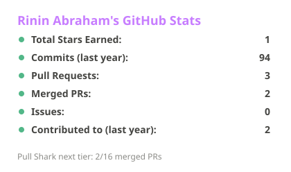
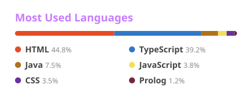

# Rinin Abraham

**Backend Engineer · Computer Science @ UT Dallas (Dec 2027)**

🔍 **Open to:** TODO_ROLES

---

### about

I build backend systems where correctness matters: rules enforced on the server, data that can't be double-counted, and services that run the same on a laptop as on a mainframe. I work mostly in **Python** and **TypeScript**, with **Docker** and **REST APIs**.

---

### experience

**Pluralsight** · TODO_TITLE · May–Aug 2026
- TODO_BULLET_1
- TODO_BULLET_2
- TODO_BULLET_3

---

### featured projects

#### 🛡️ [Senior Scam Shield](https://github.com/nikhilraghav018/IBM-Z-DATATHON_Senior-Scam-Shield) · IBM Z Datathon 2026
Real-time fraud detection for senior scams, where the victim makes every move themselves, so no single transaction looks wrong. The system links a customer's money moves across days and channels (online, branch, phone, wire) into scam chains and responds in tiers: warn, pause, hold with a trusted-contact alert, or escalate. Runs on **IBM LinuxONE (s390x, z17)**.

**My part: the decision engine.**
- Rule engine that links warning signs over a rolling 7-day window and picks the response tier
- Pure Python standard library, zero installs, architecture-independent (big-endian s390x behaves exactly like a laptop)
- ~30,000 decisions/sec on one core, with per-customer memory bounded by the window
- 25 unit tests, including five innocent look-alikes (home buyer, crypto investor, tax payment…) that must never be held
- Pluggable ML scorer hook: a model can add a risk score without being able to break the rules

`Python` `IBM LinuxONE` `FastAPI` `Docker` · team of 4

#### 📚 [Cited](https://github.com/RininAbraham1/cited) · [live](https://cited.app.space)
Multiplayer trivia where every answer comes with proof. A host picks any topic; Cited pulls Wikipedia articles, Claude drafts questions, and each question is **verified against the article text** before anyone sees it. Each reveal shows the exact sentence that proves the answer.
- **Server-enforced rules:** role-based access hides the answer key from every browser (host included) until the reveal; every move is a validated server action tied to a verified JWT
- **Race-safe scoring:** scores are recomputed from an append-only ledger, never incremented, so retries and overlapping requests can't create or destroy points
- Live rooms over WebSockets, background generation jobs, rate limiting, and an integration proxy locked down to prevent credit leaks

`TypeScript` `React` `WebSockets` `Claude API` `RBAC`

---

### skills

---

### more projects

[TicketIQ](https://github.com/RininAbraham1/TicketIQ) (multi-service Flask + Docker ticketing) · [Algorithm Visualizer](https://github.com/RininAbraham1/Algorithm-Visualizer) (JavaFX sorting & pathfinding) · [Album Score Ranker](https://github.com/RininAbraham1/Album-Score-Ranker) (Flask ratings API)

---

### github stats

